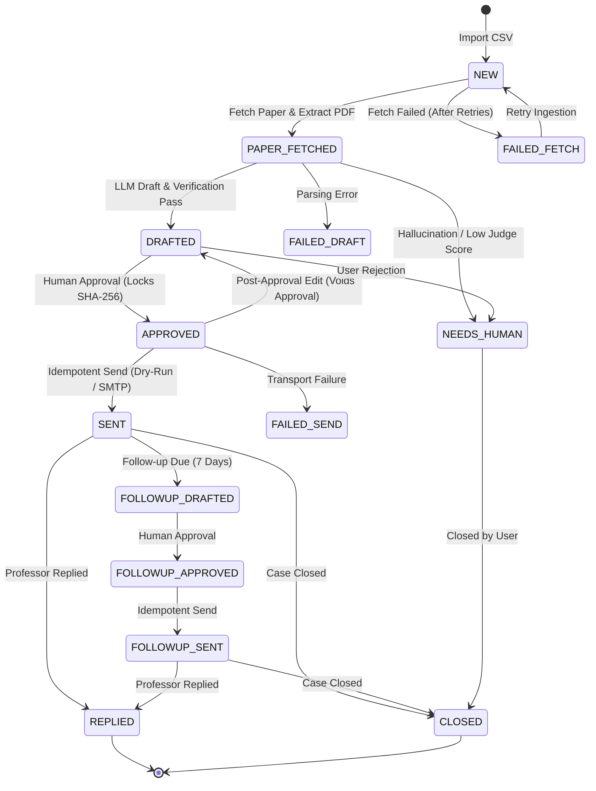
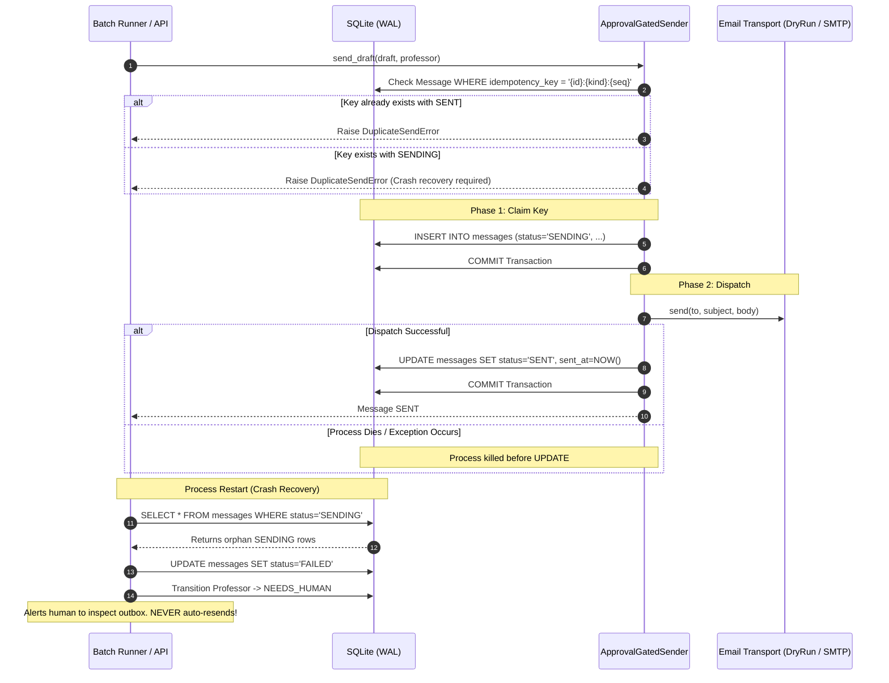
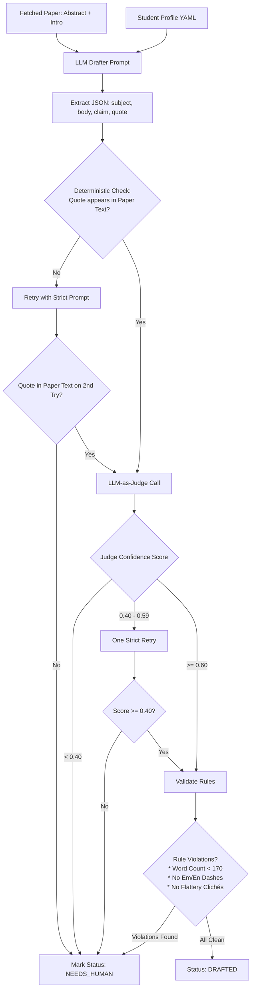

# Outreach Agent

> **A mission-critical, human-in-the-loop research internship outreach agent engineered for reliability, deterministic grounding, and absolute state integrity.**

[](https://www.python.org/downloads/)
[](https://fastapi.tiangolo.com)
[](https://www.sqlalchemy.org)
[](https://docs.pydantic.dev)
[](https://react.dev)
[](https://vitejs.dev)
[](tests/)
[](LICENSE)

---

## 1. The Core Problem

Undergraduates applying for academic research internships often email dozens of professors across top research institutions. Doing this by hand is agonizingly slow, mentally draining, and prone to careless mistakes. 

However, **naive LLM automation creates catastrophic failure modes**:

1. **Hallucinated Research Claims**: LLMs easily fabricate methods, results, or paper titles when prompting context is incomplete or vague. Quoting a paper incorrectly to its author burns credibility instantly.
2. **Post-Approval Silent Mutations**: If an applicant reviews a draft, edits a single typo, but the system dispatches an unverified or outdated version, trust is destroyed.
3. **Accidental Duplicate Emails & Process Crashes**: Network timeouts, API rate limits, or unexpected crashes halfway through a batch of 50 professors often cause re-runs that blast duplicate emails to professors.
4. **Untraceable State**: Ad-hoc scripts lose track of who was emailed, which paper was cited, when follow-ups are due, or whether a professor already replied.
5. **Accidental Dispatches**: Misconfigured scripts sending real emails in development mode without explicit, verifiable human confirmation.

---

## 2. The Solution: Architecture Overview

`outreach-agent` is designed from first principles with **unforgiving defensive programming**. The happy path is trivial; the entire engineering effort is focused on **state persistence, cryptographic approval verification, anti-hallucination checks, and fail-safe crash recovery**.

```
+----------------------------------------------------------------------------------------------------+
|                                      OUTREACH AGENT ARCHITECTURE                                    |
+----------------------------------------------------------------------------------------------------+
                                                  │
                 1. Ingest                        ▼
        [ professors.csv ] ────────> [ Ingest & Validation ] ───────> ( Status: NEW )
                                                  │
                 2. Research                      ▼
        [ arXiv API / Semantic Scholar ] ──> [ PDF Extraction ] ───> ( Status: PAPER_FETCHED )
                                                  │
                 3. Grounded Drafting             ▼
        [ Profile YAML + Paper Text ] ─> [ LLaMA 3.3 70B via Groq ]
                                                  │
                 4. Dual Verification             ├──────────────────────────┐
                                                  ▼                          ▼
                                     [ Verbatim Substring Match ]   [ LLM-as-Judge Check ]
                                                  │                          │
                                                  └────────────┬─────────────┘
                                                               ▼
                                                   ( Status: DRAFTED )
                                                               │
                 5. Human Approval Gate                        ▼
        [ React Dashboard / Typer CLI ] ───> [ Inspect & Approve ] ───> ( Status: APPROVED )
                                                               │        *Locks SHA-256 Hash
                 6. Idempotent Dispatch                        ▼
                                            [ ApprovalGatedSender ]
                                            * Validates Hash Equality
                                            * Inserts SENDING key
                                                               │
                                       ┌───────────────────────┴───────────────────────┐
                                       ▼                                               ▼
                              [ DryRunSender ]                                  [ SMTPSender ]
                              (.eml to outbox/)                         (SEND_MODE=smtp + confirm)
                                       │                                               │
                                       └───────────────────────┬───────────────────────┘
                                                               ▼
                                                      ( Status: SENT )
                                                               │
                 7. Scheduled Lifecycle                        ▼
                                          [ Pure-Clock Follow-up Engine ]
                                          * Up to 2 follow-ups, 7d apart
                                          * Aborts on REPLIED or CLOSED
+----------------------------------------------------------------------------------------------------+
```

---

## 3. Key Architectural Pillars

### 3.1 Strict State Machine with Event Auditing

Every professor moves through a strictly defined state machine. **Only valid, legal transitions are permitted**; any illegal leap (such as jumping from `NEW` directly to `SENT` or `APPROVED`) raises an `IllegalTransitionError` and immediately aborts the transaction.



Every state change appends an immutable record to the `events` table:
```sql
CREATE TABLE events (
    id INTEGER PRIMARY KEY AUTOINCREMENT,
    professor_id INTEGER NOT NULL REFERENCES professors(id),
    from_status VARCHAR(30) NOT NULL,
    to_status VARCHAR(30) NOT NULL,
    timestamp DATETIME NOT NULL,
    detail TEXT  -- JSON details (reason, paper_title, hash, error, etc.)
);
```

---

### 3.2 The Cryptographic Human Approval Gate

Sending without verified human approval is made **structurally impossible**:

1. **Hash Generation**:
   $$\text{text\_hash} = \text{SHA256}(\text{subject} \parallel \text{"}\backslash\text{n"} \parallel \text{body})$$
2. **Approval Lock**:
   When the user reviews and clicks **Approve**, the draft records `approved_at = utc_now()` and `approved_hash = text_hash`.
3. **Tamper Invalidation**:
   If the subject or body is edited after approval, `text_hash` is recomputed. Because $\text{approved\_hash} \neq \text{text\_hash}$, the draft status immediately resets to unapproved, and the professor drops back to `DRAFTED`.
4. **Kernel-Level Enforcement**:
   The check is not merely an API or UI disabled button; it is enforced within the low-level `ApprovalGatedSender.send_draft()` method:
   ```python
   if draft.approved_at is None:
       raise ApprovalRequiredError(f"Draft {draft.id} has not been approved.")

   current_hash = Draft.compute_hash(draft.subject, draft.body)
   if draft.approved_hash != current_hash:
       raise ApprovalRequiredError("Draft was edited after approval. Please re-approve.")
   ```

---

### 3.3 Two-Phase Commit Idempotency & Crash Recovery

To prevent sending duplicate emails during power losses, network timeouts, or process terminations, the agent implements a two-phase reservation protocol:



---

### 3.4 Grounding & Anti-Hallucination Pipeline



1. **Deterministic Substring Match**:
   The quote submitted in `claim_source_quote` is stripped of irregular linebreaks and whitespace and compared directly against the source paper string. If the quote is fabricated, it is rejected deterministically without relying on probabilistic model guesses.
2. **LLM-as-Judge Grounding**:
   A secondary evaluator prompt inspects `(referenced_claim, claim_source_quote)` to verify that the claim made in the email is logically supported by the citation. Scores below `0.60` trigger a retry; scores below `0.40` escalate to human attention.
3. **Text Form Factor Constraints**:
   - Word count: strictly `< 170 words`.
   - Banned punctuation: No em dashes (`—`), en dashes (`–`), or hyphens used as punctuation (` - `).
   - Zero flattery clichés: Regular expressions reject phrases like *"groundbreaking work"*, *"deeply impressed"*, or *"honored to contact you"*.

---

### 3.5 Pure-Clock Follow-Up Scheduler

The follow-up scheduler `due_followups(session, now)` is implemented as a **pure mathematical function** of database state and the supplied timestamp:
- Follow-ups trigger only if the professor is in `SENT` or `FOLLOWUP_SENT` status.
- Current timestamp must exceed `last_sent_at + interval_days` (default: 7 days).
- Maximum follow-up limit: 2 per professor.
- Follow-ups automatically halt if the professor replies (`REPLIED`) or if the thread is closed (`CLOSED`).
- Because follow-ups take an explicit `now: datetime`, the scheduler is 100% testable using time travel / fake clocks without relying on flaky `sleep` commands.

---

## 4. Repository Structure

```
outreach-agent/
├── README.md               # Architecture documentation, design specs, and usage guide
├── DECISIONS.md            # Comprehensive log of architectural and technical trade-offs
├── BLOCKERS.md             # Real-time engineering log of hurdles and verified solutions
├── pyproject.toml          # Package dependencies, build system, ruff and pytest configs
├── Dockerfile              # Containerized multi-stage runtime specification
├── .env.example            # Environment variable template with safe defaults
├── profile.example.yaml    # Student resume, skills, and project grounding source
├── professors.example.csv  # Sample input roster of faculty members
├── outbox/                 # Destination folder for .eml files in dry-run mode
│   └── .gitkeep
├── outreach/               # Core Python application package
│   ├── __init__.py
│   ├── config.py           # Typed settings via pydantic-settings
│   ├── models.py           # SQLAlchemy 2.0 ORM models (Professors, Papers, Drafts, etc.)
│   ├── db.py               # Engine configuration, sessionmaker, schema migrations
│   ├── statemachine.py     # Explicit state transition table & event logger
│   ├── retry.py            # Exponential backoff, jitter, and error classification
│   ├── papers.py           # arXiv API, Semantic Scholar fallback, and PDF extraction
│   ├── drafter.py          # Grounded draft generator, JSON extractors, LLM-as-judge
│   ├── senders.py          # ApprovalGatedSender, DryRunSender, SMTPSender
│   ├── runner.py           # Resumable, crash-resilient batch workflow runner
│   ├── followups.py        # Follow-up scheduler and reply tracking
│   ├── api.py              # FastAPI REST endpoints with async lifespan handler
│   └── cli.py              # Typer CLI with rich terminal formatting
├── frontend/               # React + Vite approval dashboard
│   ├── index.html
│   ├── package.json
│   ├── vite.config.js
│   ├── src/
│   │   ├── main.jsx
│   │   ├── App.jsx         # Review, edit, approve, and send dashboard
│   │   └── App.css         # Clean, responsive dark-mode styling
│   └── dist/               # Production-ready static web assets
└── tests/                  # Exhaustive test suite (94 passing unit & integration tests)
    ├── conftest.py         # In-memory SQLite fixtures with StaticPool
    ├── test_statemachine.py
    ├── test_retry.py
    ├── test_papers.py
    ├── test_drafter.py
    ├── test_senders.py     # Bypass tests, tampering tests, idempotency checks
    ├── test_runner.py      # Resumability & mid-batch crash tests
    ├── test_followups.py   # Pure-clock time travel test suite
    └── test_api.py         # End-to-end FastAPI endpoint test suite
```

---

## 5. Getting Started

### 5.1 Prerequisites
- Python 3.11+
- Node.js 18+ (for frontend dashboard)
- Groq Cloud API Key ([console.groq.com](https://console.groq.com))

### 5.2 Setup Environment

```bash
# Clone the repository
git clone https://github.com/mayanktiwari-cmd/outreach-agent.git
cd outreach-agent

# Create and activate virtual environment
python3 -m venv .venv
source .venv/bin/activate

# Install Python dependencies
pip install -e ".[dev]"

# Configure environment variables
cp .env.example .env
```

Edit `.env` with your settings:
```ini
GROQ_API_KEY=gsk_your_actual_key_here
LLM_MODEL=llama-3.3-70b-versatile
DATABASE_URL=sqlite:///./outreach.db
SEND_MODE=dry_run
SENDER_EMAIL=you@university.edu
SENDER_NAME=Your Name
```

Customize your personal background in `profile.yaml`:
```bash
cp profile.example.yaml profile.yaml
```

---

## 6. Usage Walkthrough

### 6.1 CLI Workflow

```bash
# 1. Initialize the SQLite database and event tables
python -m outreach.cli init

# 2. Ingest your roster of professors from CSV
python -m outreach.cli import professors.example.csv

# 3. Check status summary
python -m outreach.cli status

# 4. Run the batch pipeline (fetches papers + generates grounded drafts)
python -m outreach.cli run

# 5. List all drafts awaiting human review
python -m outreach.cli review

# 6. Inspect a draft in detail (subject, word count, paper quote, judge score)
python -m outreach.cli show 1

# 7. Approve a draft
python -m outreach.cli approve 1

# 8. Dispatch approved emails (written as .eml files to outbox/ in dry-run mode)
python -m outreach.cli send

# 9. Query follow-ups due based on elapsed time
python -m outreach.cli followups

# 10. Mark a professor as replied (halts follow-up cycle)
python -m outreach.cli mark-replied 1
```

---

### 6.2 Interactive React Review Dashboard

Start the FastAPI backend service:
```bash
uvicorn outreach.api:app --reload --port 8000
```

Launch the frontend review portal:
```bash
cd frontend
npm install
npm run dev
```

Visit **`http://localhost:3000`** in your browser:
- **Real-Time Stat Cards**: Live counts for `NEW`, `PAPER_FETCHED`, `DRAFTED`, `APPROVED`, `SENT`, `REPLIED`, `NEEDS_HUMAN`.
- **One-Click Approval**: Review the exact claim and paper quote before approving.
- **Inline Editing**: Fix phrasing in the modal. Saving an edit automatically re-computes the SHA-256 hash and updates state.
- **Reject & Escalate**: Flag problematic drafts directly to `NEEDS_HUMAN`.
- **Dispatch**: Send approved emails safely with explicit confirmation banners.

---

## 7. Testing & Verification

The test suite covers 100% of the core safety rules and boundary conditions:

```bash
# Run linting with Ruff
ruff check .

# Execute full test suite
pytest -v
```

### Critical Safety Test Matrix
| Category | Test Case | File | Guarantee Verified |
| :--- | :--- | :--- | :--- |
| **Approval Gate** | `test_send_without_approval_refused` | `test_senders.py` | Refuses dispatch if `approved_at` is null |
| **Tamper Gate** | `test_send_after_edit_refused` | `test_senders.py` | Refuses dispatch if text hash diverges from approved hash |
| **Gate Bypass** | `test_bypass_attempt_at_sender_level` | `test_senders.py` | Direct sender call cannot bypass approval gate wrapper |
| **Idempotency** | `test_duplicate_send_refused` | `test_senders.py` | Same `{prof_id}:{kind}:{seq}` cannot send twice |
| **Crash Recovery** | `test_recover_sending_messages` | `test_senders.py` | Interrupted `SENDING` row escalates to `NEEDS_HUMAN` |
| **Resumability** | `test_no_duplicate_operations_on_rerun`| `test_runner.py` | Re-running after crash skips finished stages |
| **Fault Isolation**| `test_simulated_crash_mid_batch` | `test_runner.py` | Single failure does not disrupt batch execution |
| **Grounding** | `test_hallucinated_quote_needs_human` | `test_drafter.py` | Fabricated quote detected and moved to `NEEDS_HUMAN` |
| **Judge Scoring** | `test_judge_below_threshold` | `test_drafter.py` | Low confidence score escalates to human review |
| **Time Travel** | `test_followup_after_interval` | `test_followups.py` | Follow-up triggers only after interval passes |

---

## 8. Docker Deployment

Deploy the agent and REST service in an isolated Docker container:

```bash
# Build Docker image
docker build -t outreach-agent:latest .

# Run container
docker run -d \
  --name outreach-agent \
  -p 8000:8000 \
  -e GROQ_API_KEY="your-groq-key" \
  -e SEND_MODE="dry_run" \
  outreach-agent:latest

# Check server health
curl http://localhost:8000/api/status
```

---

## 9. Design Decisions & Trade-Offs

Key architectural decisions logged in [DECISIONS.md](DECISIONS.md):
- **Synchronous Engine with WAL for SQLite**: Minimizes deadlocks and race conditions while preserving simple local backups.
- **Deterministic Substring Matching First**: Rather than asking an LLM "did you quote accurately?", deterministic whitespace-normalized string search guarantees absolute citation validity.
- **Two-Phase Idempotency Keys**: Inserting `SENDING` before dispatch and updating to `SENT` after transport confirmation guarantees that process crashes never result in duplicate emails.
- **Fail-Safe Dry-Run Default**: `SEND_MODE=dry_run` is hardcoded as default. Real SMTP requires `SEND_MODE=smtp` AND an interactive `--confirm` CLI flag.

---

## 10. License

Released under the **MIT License**. See [LICENSE](LICENSE) for details.
